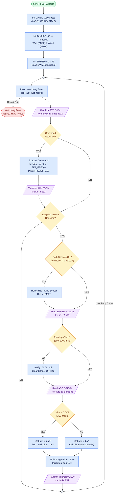
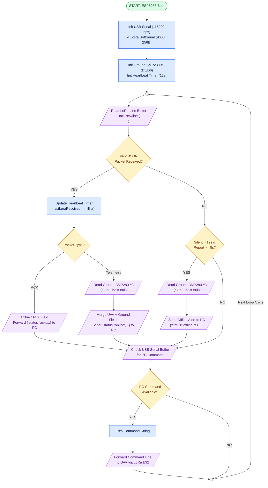
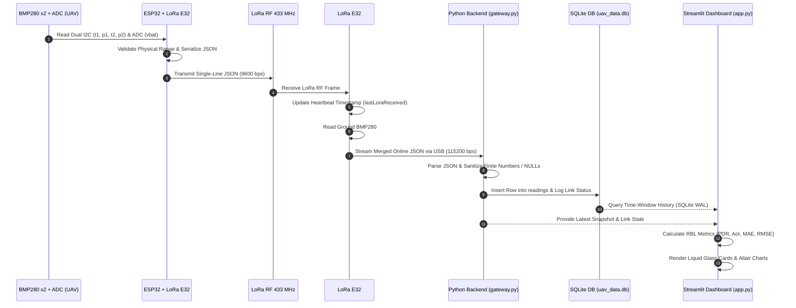
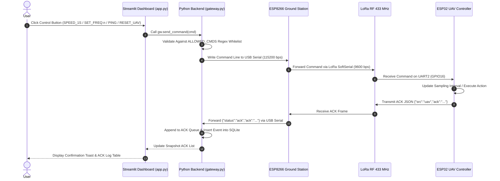

# System Architecture, Hardware Block Diagram, Flowchart & Data Flow

Thư mục này chứa các sơ đồ kỹ thuật mô tả kiến trúc và hoạt động của hệ thống **Adaptive IoT-UAV Environmental Monitoring System (Group 5 — IOT102)**.

Các sơ đồ được thiết kế theo nguyên tắc phân cấp chức năng, thống nhất ký hiệu chuẩn quốc tế (**ANSI X3.5 / ISO 5807**), thể hiện rõ chiều truyền tín hiệu và phân biệt rạch ròi giữa luồng dữ liệu (*Data Flow*), luồng điều khiển (*Control Flow*) và đường cấp nguồn (*Power Rail*).

## Diagram Index

| No. | Diagram | Description |
|---|---|---|
| **01** | **Hardware Block Diagram** | Kiến trúc phần cứng, phân cấp nguồn và kết nối bus giao tiếp giữa các module |
| **02** | **Firmware Control Flowchart** | Lưu đồ thuật toán thực thi và xử lý ngoại lệ trên ESP32 (UAV) và ESP8266 (Ground) |
| **03** | **End-to-End Data Flow** | Luồng dữ liệu Telemetry chiều xuống, lệnh điều khiển chiều lên và xác nhận ACK |

---

# 1. Hardware Block Diagram & Hardware Interfacing

**Mục đích:** Mô tả kiến trúc phần cứng tổng thể, phân cấp các module chức năng, biên cấp nguồn và giao tiếp tín hiệu giữa các thành phần.

**Quy ước ký hiệu đường dây:**
- **Đường liền 1 chiều (`-->`):** Luồng dữ liệu 1 chiều (`ADC`, `RF Downlink`, truy vấn dữ liệu).
- **Đường liền 2 chiều (`<-->`):** Bus giao tiếp dữ liệu 2 chiều (`I2C`, `UART`, `USB Serial`, `SQLite WAL`).
- **Đường nét đứt (`-.->`):** Đường cấp nguồn (`+12V`, `+5.0V`, `+3.3V`) và luồng tín hiệu điều khiển (`Uplink Command`).

```mermaid
flowchart LR
    subgraph UAV["1. UAV STATION — ESP32 DEVKIT V1"]
        direction TB

        subgraph POWER_UAV["POWER MANAGEMENT (UAV)"]
            direction LR
            BAT["LiPo Battery 3S<br/>11.1V – 12.6V"]
            BUCK["Mini 360 Buck Converter<br/>Regulated Output: 5.0V"]
            BAT -->|"+12V DC (IN+ / IN-)"| BUCK
        end

        subgraph SENSORS_UAV["DUAL-I2C SENSOR ARRAY"]
            direction TB
            BMP1["BMP280 #1<br/>Unshielded (Exposed)"]
            BMP2["BMP280 #2<br/>Pagoda Shielded"]
            ADC["Battery Voltage Monitor<br/>Divider: 100kΩ / 33kΩ"]
        end

        MCU["ESP32 DevKit V1<br/>Main Airborne Controller<br/>Hardware Watchdog: 15s"]

        RADIO_TX["LoRa E32-433T20D (#1)<br/>UAV RF Transceiver<br/>M0 = M1 = GND (Mode 0)"]

        BUCK -.->|"+5.0V VIN / GND"| MCU
        BUCK -.->|"+5.0V VCC / GND"| RADIO_TX
        BAT -.->|"Raw V_BAT"| ADC

        BMP1 <-->|"I2C-0 (Wire)<br/>SDA: GPIO21 / SCL: GPIO22"| MCU
        BMP2 <-->|"I2C-1 (Wire1)<br/>SDA: GPIO18 / SCL: GPIO19"| MCU
        ADC -->|"ADC1_CH6 (GPIO34)"| MCU

        MCU <-->|"UART2 — 9600 bps 8N1<br/>RX2: GPIO16 / TX2: GPIO17"| RADIO_TX
    end

    subgraph RF["2. WIRELESS CHANNEL (433 MHz)"]
        direction TB
        RF_DOWN["Downlink Channel (433 MHz)<br/>Telemetry JSON + Command ACK"]
        RF_UP["Uplink Channel (433 MHz)<br/>SPEED_1S / 5S | SET_FREQ:n | PING | RESET"]
    end

    subgraph GROUND["3. GROUND STATION — ESP8266 & PC"]
        direction TB

        USB_PWR["USB 5.0V Power Supply<br/>From Ground PC Port"]

        RADIO_RX["LoRa E32-433T20D (#2)<br/>Ground RF Transceiver<br/>M0 = M1 = GND (Mode 0)"]

        ESP8266["ESP8266 NodeMCU<br/>Ground Gateway Controller<br/>Heartbeat Timeout: 12s"]

        BMP3["BMP280 #3<br/>Ground Reference Sensor"]

        subgraph PC_SYSTEM["GROUND CONTROL PC SYSTEM"]
            direction TB
            GW["Python Backend (gateway.py)<br/>Daemon Reader + Command Whitelist"]
            DB[("SQLite Database<br/>uav_data.db (WAL Mode)")]
            UI["Streamlit Dashboard (app.py)<br/>Apple Liquid Glass UI<br/>Altair Charts + RBL KPIs"]

            GW <-->|"SQL Read / Write"| DB
            DB -->|"Historical Series"| UI
            GW -->|"Live Snapshot & ACK"| UI
            UI -.->|"Validated Command"| GW
        end

        USB_PWR -.->|"+5.0V VIN / GND"| RADIO_RX
        USB_PWR -.->|"+5.0V / +3.3V / GND"| ESP8266

        RADIO_RX <-->|"SoftwareSerial (9600 bps, 256B)<br/>RX: D2 (GPIO4) / TX: D1 (GPIO5)"| ESP8266
        BMP3 <-->|"I2C Ground<br/>SDA: D5 (GPIO14) / SCL: D6 (GPIO12)"| ESP8266
        ESP8266 <-->|"USB Serial — 115200 bps<br/>Online / Offline / ACK / Commands"| GW
    end

    RADIO_TX -->|"RF TX (100mW)"| RF_DOWN
    RF_DOWN -->|"RF RX"| RADIO_RX

    RADIO_RX -.->|"RF TX (Uplink)"| RF_UP
    RF_UP -.->|"RF RX"| RADIO_TX

    classDef power fill:#fef3c7,stroke:#d97706,color:#78350f
    classDef controller fill:#dbeafe,stroke:#2563eb,color:#172554
    classDef sensor fill:#dcfce7,stroke:#16a34a,color:#14532d
    classDef radio fill:#f3e8ff,stroke:#9333ea,color:#581c87
    classDef software fill:#e0f2fe,stroke:#0284c7,color:#0c4a6e

    class BAT,BUCK,USB_PWR power
    class MCU,ESP8266 controller
    class BMP1,BMP2,BMP3,ADC sensor
    class RADIO_TX,RADIO_RX,RF_DOWN,RF_UP radio
    class GW,DB,UI software
```

### Hardware Interface Specification

| Component | Interface | Connection Pins | Function |
|---|---|---|---|
| **BMP280 #1 (UAV)** | Hardware I2C-0 (`Wire`) | `SDA: GPIO21` / `SCL: GPIO22` (`3.3V`) | Unshielded temperature & pressure sensing (`t1, p1`) |
| **BMP280 #2 (UAV)** | Hardware I2C-1 (`Wire1`) | `SDA: GPIO18` / `SCL: GPIO19` (`3.3V`) | Pagoda-shielded sensing against rotor downwash (`t2, p2`) |
| **LoRa E32 #1 (UAV)** | Hardware UART2 (`Serial2`) | `RX2: GPIO16` / `TX2: GPIO17` (`5.0V`) | 433 MHz wireless telemetry & command reception |
| **Battery Monitor** | Analog ADC1 (`12-bit`) | `GPIO34` (`100kΩ / 33kΩ` divider) | 3S LiPo pack voltage (`vbat`), percentage (`bat`) & `pwr` mode |
| **LoRa E32 #2 (Ground)** | `SoftwareSerial` (256B) | `RX: D2 (GPIO4)` / `TX: D1 (GPIO5)` (`5.0V`) | Ground 433 MHz wireless reception & command uplink |
| **BMP280 #3 (Ground)** | Ground I2C (`Wire`) | `SDA: D5 (GPIO14)` / `SCL: D6 (GPIO12)` (`3.3V`) | Ground station reference measurement (`t3, p3`) |
| **ESP8266 to PC** | USB Serial (UART0) | MicroUSB (`115200 bps 8N1`) | Real-time JSON streaming & two-way command forwarding |

**Important Hardware Notes:**
- Both LoRa E32-433T20D modules operate at **433 MHz** in **Transparent Mode 0** (`M0 = GND`, `M1 = GND`, `AUX` left floating with software buffer management).
- The airborne station uses a **Mini 360 DC-DC Buck Converter** calibrated to **5.0V** to prevent overvoltage damage from the 3S LiPo battery (`12.6V`) and avoid brownout resets during 100mW RF transmission bursts.
- BMP280 modules (Silicon ID `0x58`) measure temperature and pressure; humidity fields (`h1, h2, h3`) are explicitly output as `null` (never fake `0.0`).

---

# 2. Firmware Control Flowchart & Exception Handling

**Mục đích:** Mô tả trình tự thực thi thuật toán theo chuẩn **ANSI X3.5 / ISO 5807**, các điểm quyết định rẽ nhánh, cơ chế tự phục hồi cảm biến I2C và xử lý ngoại lệ phần cứng.

**Quy ước hình khối chuẩn ISO 5807:**
- **Oval (`([...])`):** Điểm bắt đầu (`START`) hoặc kết thúc/khởi động lại phần cứng (`Hard Reset`).
- **Rectangle (`[...]`):** Bước xử lý, khởi tạo hoặc tính toán nội bộ (*Process*).
- **Diamond (`{...}`):** Điểm kiểm tra điều kiện rẽ nhánh (*Decision: YES / NO*).
- **Parallelogram (`[/.../]`):** Thao tác Nhập / Xuất ngoại vi (*Input / Output*).
- **Circle (`(( ))`):** Điểm nối gom vòng lặp trong trang (*On-Page Loop Connector*).
- **Solid arrows (`-->`):** Luồng thực thi chính.
- **Dashed arrows (`-.->`):** Luồng ngắt ngoại lệ phần cứng (*Hardware Watchdog Exception*).

## 2.1. UAV Firmware Flowchart — ESP32 (`Firmware_UAV_ESP32.ino`)

## 2.2. Ground Station Firmware Flowchart — ESP8266 (`Firmware_Ground_ESP8266.ino`)

### Firmware Exception Handling Summary

| Exception / Fault Scenario | Detection Mechanism | Recovery & Handling Action |
|---|---|---|
| **ESP32 MCU Hang / Lockup** | Hardware Watchdog Timer (`> 15s`) | Automatic panic & hardware reboot (`esp_task_wdt`) |
| **I2C Bus Hang (Loose Wire)** | `Wire.setTimeOut(50)` (`50ms`) | Abort blocking read, mark `bme_ok = false`, re-run `initBMP()` next cycle |
| **Invalid Sensor Measurement** | `isnan()` or Pressure $\notin [300, 1100]\text{ hPa}$ | Output JSON `null` (`nullptr`) to preserve statistical integrity (never fake `0`) |
| **USB Bench Power (No LiPo)** | `vbat < 6.0V` on `GPIO34` | Set `"pwr": "usb"`, `"bat": null`, `"vbat": null` |
| **LoRa RF Link Loss** | Heartbeat timeout (`> 12s` on ESP8266) | Emit `{"status":"offline","t3":...}` every `5s` while keeping local ground readings |
| **USB Cable / Gateway Silent** | `last_msg_age > 20s` in `app.py` | Display critical red banner alerting USB cable or ESP8266 power loss |
| **Invalid / Corrupted Command** | Regex Whitelist `ALLOWED_CMDS` in `gateway.py` | Reject command at PC gateway before serial transmission |

---

# 3. End-to-End Telemetry & Command Data Flow

**Mục đích:** Mô tả luồng di chuyển của gói tin từ tầng vật lý trên UAV đến cơ sở dữ liệu SQLite, giao diện Dashboard và chiều điều khiển ngược lại từ người dùng lên UAV.

**Quy ước:**
- **Đường liền (`-->`):** Luồng dữ liệu cảm biến và phản hồi (`Telemetry & ACK Stream`: UAV → Ground → Backend → SQLite → Dashboard).
- **Đường nét đứt (`-.->`):** Luồng lệnh điều khiển từ người dùng (`Uplink Command`: Dashboard → Backend → Ground → LoRa RF → UAV).

```mermaid
flowchart LR
    subgraph UAV["1. UAV DATA ACQUISITION"]
        direction TB
        SENSORS["BMP280 #1 (Unshielded)<br/>BMP280 #2 (Pagoda Shield)<br/>Temperature & Pressure"]
        BATTERY["Battery ADC Monitor<br/>Voltage (V) & Level (%)"]
        ESP32["ESP32 Controller<br/>Validation & JSON Serialization<br/>Command Parser"]
        LORA_TX["LoRa E32 #1 (UAV)<br/>UART2 — 9600 bps"]

        SENSORS -->|"Dual I2C Data"| ESP32
        BATTERY -->|"ADC1 Data (GPIO34)"| ESP32
        ESP32 -->|"Telemetry / ACK JSON"| LORA_TX
    end

    subgraph WIRELESS["2. LoRa WIRELESS CHANNEL"]
        direction TB
        RF["433 MHz ISM RF Link<br/>Transparent Mode 0"]
    end

    subgraph GROUND["3. GROUND STATION"]
        direction TB
        LORA_RX["LoRa E32 #2 (Ground)<br/>SoftSerial — 9600 bps"]
        GROUND_SENSOR["BMP280 #3<br/>Ground Reference Sensor"]
        ESP8266["ESP8266 NodeMCU<br/>Packet Merger & Heartbeat FSM"]

        LORA_RX -->|"UAV JSON Line"| ESP8266
        GROUND_SENSOR -->|"I2C Data (t3, p3)"| ESP8266
    end

    subgraph PC["4. PC BACKEND & STORAGE"]
        direction TB
        GW["gateway.py<br/>Daemon Serial Reader<br/>JSON Parser & Whitelist"]
        DB[("SQLite Database<br/>uav_data.db (WAL Mode)<br/>readings & events")]

        GW -->|"Insert Readings & Events"| DB
    end

    subgraph DASHBOARD["5. VISUALIZATION & CONTROL"]
        direction TB
        UI["Streamlit Dashboard (app.py)<br/>Apple Liquid Glass UI<br/>Interactive Altair Charts"]
        KPI["Live RBL Metrics<br/>PDR / AoI / MAE / RMSE"]

        UI -->|"Compute Metrics"| KPI
    end

    LORA_TX -->|"Downlink RF"| RF
    RF -->|"Downlink RF"| LORA_RX
    ESP8266 -->|"USB Serial (115200 bps)"| GW
    DB -->|"Query Time-Series"| UI
    GW -->|"Live Snapshot & ACK"| UI

    UI -.->|"1. User Command"| GW
    GW -.->|"2. Whitelisted Command"| ESP8266
    ESP8266 -.->|"3. SoftSerial TX"| LORA_RX
    LORA_RX -.->|"4. Uplink RF"| RF
    RF -.->|"5. Uplink RF"| LORA_TX
    LORA_TX -.->|"6. UART2 RX"| ESP32

    classDef hardware fill:#dbeafe,stroke:#2563eb,color:#172554
    classDef sensor fill:#dcfce7,stroke:#16a34a,color:#14532d
    classDef communication fill:#f3e8ff,stroke:#9333ea,color:#581c87
    classDef backend fill:#e0f2fe,stroke:#0284c7,color:#0c4a6e
    classDef dashboard fill:#fef3c7,stroke:#d97706,color:#78350f

    class ESP32,ESP8266 hardware
    class SENSORS,BATTERY,GROUND_SENSOR sensor
    class LORA_TX,LORA_RX,RF communication
    class GW,DB backend
    class UI,KPI dashboard
```

## 3.1. Telemetry Transmission Sequence (Downlink)

## 3.2. Command and ACK Transmission Sequence (Uplink & Feedback)

---

# 4. Technical Diagram Conventions

The diagrams follow a consistent set of international engineering drawing conventions (**ANSI X3.5 / ISO 5807**) to ensure readability, maintainability, and academic rigor.

| Element | Visual Convention | Application in System Diagrams |
|---|---|---|
| **Functional Blocks** | Rectangle (`[...]`) | Hardware modules, MCUs, software services, and internal processing steps |
| **Terminal Boundaries** | Oval (`([...])`) | Firmware boot entry (`START`) and hardware reset termination (`Hard Reset`) |
| **Loop Connectors** | Circle (`(( ))`) | On-page convergence and loop return points (`loop()` cycle) |
| **Conditional Branches** | Diamond (`{...}`) | Logic decisions (`YES` / `NO` branches) |
| **Peripheral I/O** | Parallelogram (`[/.../]`) | Sensor acquisition, ADC sampling, UART/LoRa/USB transmission |
| **Database Storage** | Cylinder (`[(...)]`) | Persistent SQLite WAL database (`uav_data.db`) |
| **Solid Arrow (`-->`)** | Continuous line | Primary telemetry data flow and sequential execution |
| **Dashed Arrow (`-.->`)** | Segmented line | Uplink control commands, power distribution rails, and watchdog exceptions |
| **Bidirectional Arrow (`<-->`)** | Double-headed line | Half/Full-duplex hardware buses (`I2C`, `UART`, `USB Serial`, `SQLite IO`) |

## Design Principles

1. **Hierarchy:** Separate the architecture into distinct functional subsystems (UAV Airborne Station, 433 MHz Wireless Channel, Ground Gateway, and PC Control Center).
2. **Signal Direction:** Explicitly distinguish downlink telemetry (`-->`), uplink commands (`-.->`), and bidirectional buses (`<-->`).
3. **Consistency:** Maintain uniform shapes, color coding, and pinout labels across all architectural, algorithmic, and sequence diagrams.
4. **Readability:** Keep node labels concise and action-oriented without cluttering block diagrams with discrete passive components.
5. **Separation of Concerns:** Decouple physical hardware interfacing (Section 1), MCU firmware state machines (Section 2), and end-to-end data pipelines (Section 3).
6. **Traceability:** Every pin number, baudrate, timeout threshold (`15s` WDT, `50ms` I2C, `12s` LoRa Heartbeat, `20s` USB Silent), and JSON key matches the production codebase 100%.

---

**Project:** Adaptive IoT-UAV Environmental Monitoring System with Downwash-Aware Sensing and Adaptive Communication  
**Course:** IOT102 — Fall 2026  
**Team:** Group 5 (IA2103)
