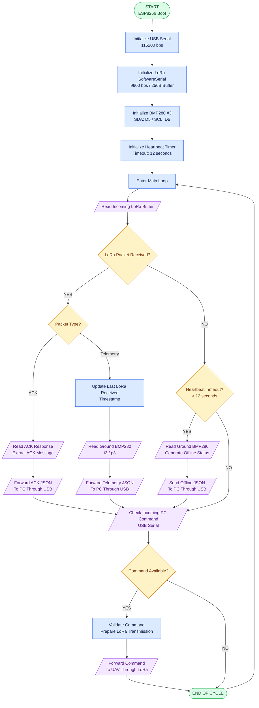
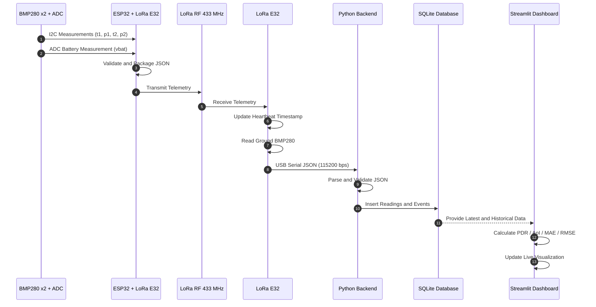
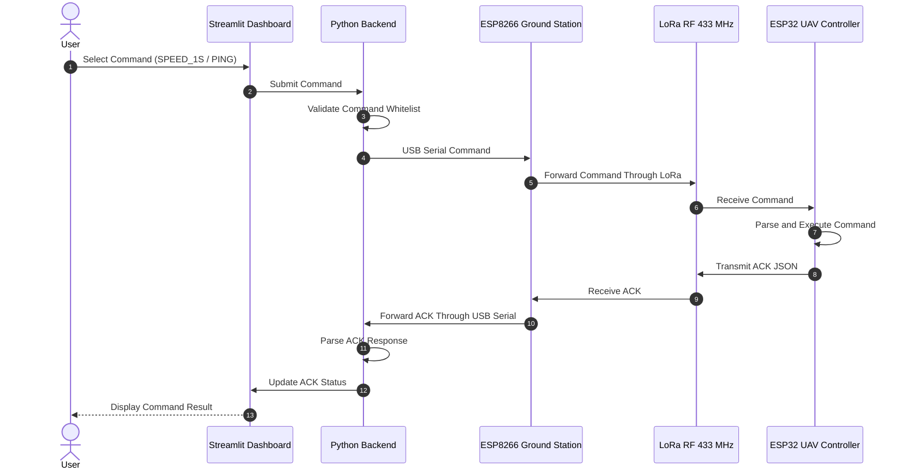

# System Architecture, Hardware Block Diagram, Flowchart & Data Flow

Thư mục này chứa các sơ đồ kỹ thuật mô tả kiến trúc và hoạt động của hệ thống **Adaptive IoT-UAV Environmental Monitoring System (Group 5 — IOT102)**.

Các sơ đồ được thiết kế theo nguyên tắc phân cấp chức năng, thống nhất ký hiệu, thể hiện rõ chiều truyền tín hiệu và phân biệt luồng dữ liệu với luồng điều khiển.

## Diagram Index

| No. | Diagram | Description |
|---|---|---|
| 01 | Hardware Block Diagram | Kiến trúc phần cứng và kết nối giữa các module |
| 02 | Firmware Control Flowchart | Thuật toán hoạt động ESP32 và ESP8266 |
| 03 | End-to-End Data Flow | Luồng Telemetry, Command và ACK |

---

# 1. Hardware Block Diagram & Hardware Interfacing

**Mục đích:** Mô tả kiến trúc phần cứng tổng thể, phân cấp các module chức năng và giao tiếp giữa các thành phần.

**Quy ước:**
- Đường liền: Luồng dữ liệu và giao tiếp.
- Đường nét đứt: Đường cấp nguồn.
- Đường nét chấm: Luồng điều khiển.
- Mũi tên một chiều: Truyền dữ liệu một chiều.
- Mũi tên hai chiều: Giao tiếp hai chiều.

```mermaid
flowchart LR

    subgraph UAV["1. UAV STATION — ESP32 DEVKIT V1"]
        direction TB

        subgraph POWER_UAV["POWER MANAGEMENT"]
            direction LR
            BAT["LiPo Battery<br/>3S — 11.1V to 12.6V"]
            BUCK["Mini 360 Buck Converter<br/>Output: 5.0V"]
            BAT -->|"IN+ / IN-"| BUCK
        end

        subgraph SENSORS_UAV["SENSOR ACQUISITION"]
            direction LR
            BMP1["BMP280 #1<br/>Unshielded"]
            BMP2["BMP280 #2<br/>Pagoda Shield"]
        end

        MCU["ESP32 DevKit V1<br/>Main Controller<br/>Watchdog: 15s"]

        ADC["Battery Monitoring<br/>ADC1 — GPIO34<br/>Voltage Divider<br/>100kΩ / 33kΩ"]

        RADIO_TX["LoRa E32-433T20D<br/>UAV RF Module<br/>M0 = M1 = GND"]

        BUCK -.->|"5V / GND"| MCU
        BUCK -.->|"5V / GND"| RADIO_TX

        BAT -.->|"Battery Voltage"| ADC
        ADC -->|"ADC Measurement"| MCU

        BMP1 <-->|"I2C-0<br/>SDA: GPIO21<br/>SCL: GPIO22"| MCU
        BMP2 <-->|"I2C-1<br/>SDA: GPIO18<br/>SCL: GPIO19"| MCU

        MCU <-->|"UART2 — 9600 8N1<br/>RX2: GPIO16<br/>TX2: GPIO17"| RADIO_TX
    end

    subgraph RF["2. WIRELESS COMMUNICATION"]
        direction TB

        RF_LINK["LoRa RF Channel<br/>433 MHz<br/>Transparent Mode 0"]

        RF_DATA["Downlink<br/>JSON Telemetry + ACK"]
        RF_CMD["Uplink<br/>SPEED_1S / SPEED_5S<br/>SET_FREQ:n / PING / RESET_UAV"]

        RF_LINK --- RF_DATA
        RF_LINK --- RF_CMD
    end

    subgraph GROUND["3. GROUND STATION — ESP8266 NODEMCU"]
        direction TB

        RADIO_RX["LoRa E32-433T20D<br/>Ground RF Module<br/>M0 = M1 = GND"]

        ESP8266["ESP8266 NodeMCU<br/>Ground Controller<br/>Heartbeat Timeout: 12s"]

        BMP3["BMP280 #3<br/>Ground Reference Sensor"]

        subgraph PC_SYSTEM["GROUND PC SYSTEM"]
            direction TB

            GW["Python Backend<br/>gateway.py<br/>Serial Reader + Command Whitelist"]

            DB[("SQLite Database<br/>uav_data.db<br/>WAL Mode")]

            UI["Streamlit Dashboard<br/>app.py<br/>Telemetry Visualization<br/>RBL Performance KPIs"]

            GW <-->|"Database Operations"| DB
            DB -->|"Stored Measurements"| UI
        end

        RADIO_RX <-->|"SoftwareSerial<br/>9600 bps<br/>RX: D2 / GPIO4<br/>TX: D1 / GPIO5"| ESP8266

        BMP3 <-->|"I2C Ground<br/>SDA: D5 / GPIO14<br/>SCL: D6 / GPIO12"| ESP8266

        ESP8266 <-->|"USB Serial — 115200 bps<br/>JSON Telemetry / Commands / ACK"| GW
    end

    RADIO_TX <-->|"433 MHz RF"| RF_LINK
    RF_LINK <-->|"433 MHz RF"| RADIO_RX

    classDef power fill:#fff3cd,stroke:#d39e00,color:#333
    classDef controller fill:#dbeafe,stroke:#2563eb,color:#172554
    classDef sensor fill:#dcfce7,stroke:#16a34a,color:#14532d
    classDef radio fill:#f3e8ff,stroke:#9333ea,color:#581c87
    classDef software fill:#e0f2fe,stroke:#0284c7,color:#0c4a6e

    class BAT,BUCK power
    class MCU,ESP8266 controller
    class BMP1,BMP2,BMP3,ADC sensor
    class RADIO_TX,RADIO_RX,RF_LINK,RF_DATA,RF_CMD radio
    class GW,DB,UI software
```

### Hardware Interface Specification

| Component | Interface | Connection | Function |
|---|---|---|---|
| BMP280 #1 | I2C-0 | GPIO21 / GPIO22 | Unshielded sensing |
| BMP280 #2 | I2C-1 | GPIO18 / GPIO19 | Pagoda-shield sensing |
| LoRa UAV | UART2 | GPIO16 / GPIO17 | Wireless communication |
| Battery Monitor | ADC1 | GPIO34 | Battery voltage measurement |
| LoRa Ground | SoftwareSerial | D2 / D1 | Wireless communication |
| BMP280 #3 | I2C | D5 / D6 | Ground reference measurement |
| ESP8266 to PC | USB Serial | 115200 bps | Telemetry and command transfer |

**Important hardware notes:**
- ESP32 and ESP8266 use separate LoRa E32-433T20D modules.
- LoRa communication operates at 433 MHz.
- LoRa modules use Transparent Mode 0.
- The UART interface between ESP32 and LoRa operates at 9600 bps.
- The ground station forwards received telemetry to the PC through USB Serial.

---

# 2. Firmware Control Flowchart & Exception Handling

**Mục đích:** Mô tả trình tự thực thi firmware, điều kiện rẽ nhánh, cơ chế phục hồi cảm biến và xử lý ngoại lệ.

**Quy ước:**
- Oval: Start / End.
- Rectangle: Processing.
- Diamond: Decision.
- Parallelogram: Input / Output.
- Solid arrows: Main execution flow.
- Dashed arrows: Exception / Watchdog flow.

## 2.1. UAV Firmware — ESP32

```mermaid
flowchart TD

    U1(["START<br/>ESP32 Boot"])

    U2["Initialize UART2<br/>9600 bps"]

    U3["Initialize ADC GPIO34<br/>Initialize Dual I2C<br/>Wire: GPIO21 / GPIO22<br/>Wire1: GPIO18 / GPIO19"]

    U4["Initialize Hardware Watchdog<br/>Timeout: 15 seconds"]

    U5["Enter Main Loop<br/>Reset Watchdog Timer"]

    U6[/"Check UART2 Buffer<br/>Read Incoming Command"/]

    U7{"Command Available?"}

    U8["Parse Command Buffer<br/>Execute SPEED_1S / SPEED_5S<br/>SET_FREQ:n / PING / RESET"]

    U9[/"Transmit Command ACK<br/>Through LoRa E32"/]

    U10{"Sampling Interval Reached?"}

    U11["Check BMP280 Status<br/>bme1_ok / bme2_ok"]

    U12{"Both Sensors Ready?"}

    U13["Reinitialize Failed Sensor<br/>Execute initBMP()"]

    U14[/"Read BMP280 Measurements<br/>t1, p1, t2, p2"/]

    U15{"Valid Sensor Data?"}

    U16["Replace Invalid Values<br/>With JSON null<br/>Pressure Range: 300–1100 hPa"]

    U17[/"Read Battery Voltage<br/>ADC GPIO34<br/>Average 16 Samples"/]

    U18{"Battery Voltage<br/>Below 6.0V?"}

    U19["Set Power Status<br/>pwr = usb<br/>bat = null"]

    U20["Calculate Battery Status<br/>Voltage and Percentage"]

    U21["Build JSON Telemetry<br/>Increment seqNo++"]

    U22[/"Transmit JSON<br/>Through LoRa E32"/]

    U23(["END OF CYCLE"])

    U1 --> U2
    U2 --> U3
    U3 --> U4
    U4 --> U5

    U5 --> U6
    U6 --> U7

    U7 -->|"YES"| U8
    U8 --> U9
    U9 --> U10

    U7 -->|"NO"| U10

    U10 -->|"NO"| U23
    U10 -->|"YES"| U11

    U11 --> U12

    U12 -->|"NO"| U13
    U12 -->|"YES"| U14

    U13 --> U14

    U14 --> U15

    U15 -->|"NO"| U16
    U15 -->|"YES"| U17

    U16 --> U17

    U17 --> U18

    U18 -->|"YES"| U19
    U18 -->|"NO"| U20

    U19 --> U21
    U20 --> U21

    U21 --> U22
    U22 --> U23

    U23 --> U5

    U5 -.->|"Watchdog Timeout > 15s"| U24["Watchdog Panic<br/>Automatic ESP32 Hard Reset"]

    classDef start fill:#dcfce7,stroke:#16a34a,color:#14532d
    classDef process fill:#dbeafe,stroke:#2563eb,color:#172554
    classDef decision fill:#fef3c7,stroke:#d97706,color:#78350f
    classDef io fill:#f3e8ff,stroke:#9333ea,color:#581c87
    classDef exception fill:#fee2e2,stroke:#dc2626,color:#7f1d1d

    class U1,U23 start
    class U2,U3,U4,U5,U8,U11,U13,U16,U19,U20,U21 process
    class U7,U10,U12,U15,U18 decision
    class U6,U9,U14,U17,U22 io
    class U24 exception
```

## 2.2. Ground Station Firmware — ESP8266

### Firmware Exception Handling

| Exception | Detection | Handling |
|---|---|---|
| ESP32 firmware hang | Watchdog timeout > 15s | Automatic hard reset |
| BMP280 initialization failure | bme1_ok / bme2_ok | Reinitialize sensor |
| Invalid sensor reading | NaN / invalid pressure | Replace value with null |
| Low battery reading | Vbat < 6.0V | Set USB power status |
| LoRa communication loss | Heartbeat timeout > 12s | Send offline status |
| Invalid command | Command validation | Reject unsupported command |

---

# 3. End-to-End Telemetry & Command Data Flow

**Mục đích:** Mô tả quá trình dữ liệu đi từ cảm biến UAV đến Dashboard và chiều ngược lại khi người dùng gửi lệnh điều khiển.

**Quy ước:**
- Telemetry: UAV → Ground Station → Backend → Database → Dashboard.
- Command: Dashboard → Backend → Ground Station → UAV.
- ACK: UAV → Ground Station → Backend → Dashboard.
- Các luồng dữ liệu được phân tách để tránh nhầm lẫn giữa Telemetry và Control.

```mermaid
flowchart LR

    subgraph UAV["1. UAV DATA ACQUISITION"]
        direction TB

        SENSORS["BMP280 #1<br/>BMP280 #2<br/>Temperature / Pressure"]

        BATTERY["Battery Monitor<br/>Voltage / Percentage"]

        ESP32["ESP32 Controller<br/>Sensor Processing<br/>JSON Packaging"]

        LORA_TX["LoRa E32 #1<br/>UART2 — 9600 bps"]

        SENSORS -->|"I2C Data"| ESP32
        BATTERY -->|"ADC Data"| ESP32
        ESP32 -->|"Telemetry JSON"| LORA_TX
    end

    subgraph WIRELESS["2. LoRa WIRELESS CHANNEL"]
        direction TB

        RF["433 MHz RF Link<br/>Transparent Mode 0"]
    end

    subgraph GROUND["3. GROUND STATION"]
        direction TB

        LORA_RX["LoRa E32 #2"]

        ESP8266["ESP8266 NodeMCU<br/>Packet Processing"]

        GROUND_SENSOR["BMP280 #3<br/>Ground Reference"]

        ESP8266 -->|"I2C Measurement"| GROUND_SENSOR
        LORA_RX -->|"UART Data"| ESP8266
    end

    subgraph PC["4. PC BACKEND & STORAGE"]
        direction TB

        GW["gateway.py<br/>Serial Reader<br/>JSON Parser<br/>Command Whitelist"]

        DB[("SQLite Database<br/>uav_data.db<br/>WAL Mode")]

        GW <-->|"Read / Write"| DB
    end

    subgraph DASHBOARD["5. VISUALIZATION"]
        direction TB

        UI["Streamlit Dashboard<br/>Live Telemetry<br/>Map View<br/>Performance KPIs"]

        KPI["Calculated Metrics<br/>PDR / AoI / MAE / RMSE"]

        UI --> KPI
    end

    LORA_TX <-->|"433 MHz RF"| RF
    RF <-->|"433 MHz RF"| LORA_RX

    ESP8266 <-->|"USB Serial<br/>115200 bps"| GW

    GW -->|"Stored Measurements"| DB
    DB -->|"Historical / Latest Data"| UI

    UI -.->|"User Command"| GW
    GW -.->|"USB Serial Command"| ESP8266
    ESP8266 -.->|"LoRa Uplink Command"| LORA_RX

    classDef hardware fill:#dbeafe,stroke:#2563eb,color:#172554
    classDef sensor fill:#dcfce7,stroke:#16a34a,color:#14532d
    classDef communication fill:#f3e8ff,stroke:#9333ea,color:#581c87
    classDef backend fill:#e0f2fe,stroke:#0284c7,color:#0c4a6e
    classDef dashboard fill:#fef3c7,stroke:#d97706,color:#78350f

    class ESP32,ESP8266 hardware
    class SENSORS,BATTERY,GROUND_SENSOR sensor
    class LORA_TX,LORA_RX,RF communication
    class GW,DB backend
    class UI,KPI dashboard
```

## 3.1. Telemetry Transmission Sequence

## 3.2. Command and ACK Transmission Sequence

---

# 4. Technical Diagram Conventions

The diagrams follow a consistent set of technical drawing conventions to improve readability, maintainability, and technical communication.

| Element | Convention | Application |
|---|---|---|
| Functional blocks | Rectangle | Hardware and software modules |
| Start / End | Oval | Firmware execution boundaries |
| Decision | Diamond | Conditional branches |
| Input / Output | Parallelogram | Sensor reading and data transmission |
| Solid arrow | Data flow | Telemetry and measurement |
| Dashed arrow | Control flow / power | Commands, exceptions, power |
| Bidirectional arrow | Two-way communication | UART, I2C, LoRa |
| Subgraph | Functional hierarchy | UAV, RF, Ground Station |

## Design Principles

1. **Hierarchy:** Separate the system into independent functional subsystems.
2. **Signal Direction:** Clearly identify the direction of data and command transmission.
3. **Consistency:** Use consistent shapes, labels, and colors for equivalent functions.
4. **Readability:** Keep block descriptions concise and avoid unnecessary technical details.
5. **Separation of Concerns:** Separate hardware architecture, firmware execution, and end-to-end data communication.
6. **Traceability:** Ensure each diagram represents the same hardware interfaces and communication architecture.

---

**Project:** Adaptive IoT-UAV Environmental Monitoring System with Downwash-Aware Sensing and Adaptive Communication

**Course:** IOT102 — Fall 2026

**Team:** Group 5
