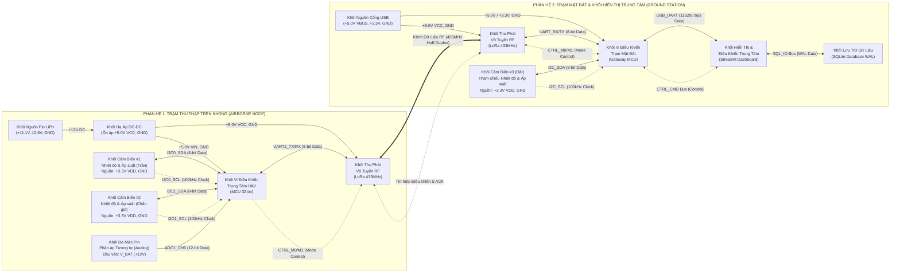
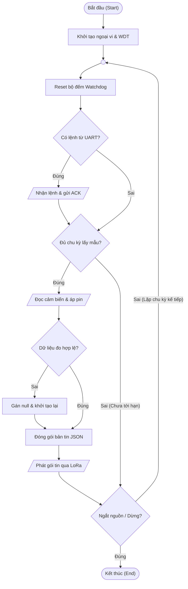
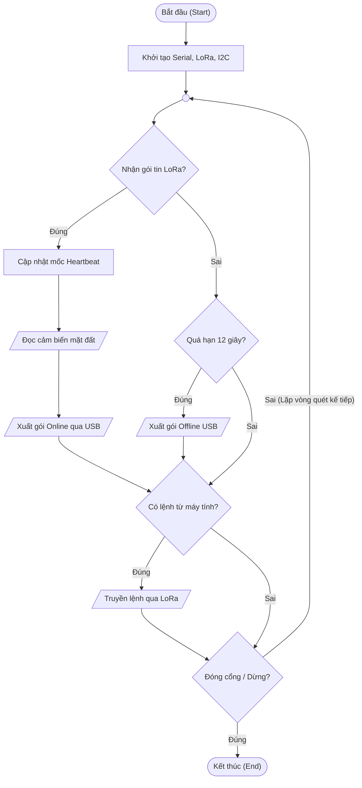
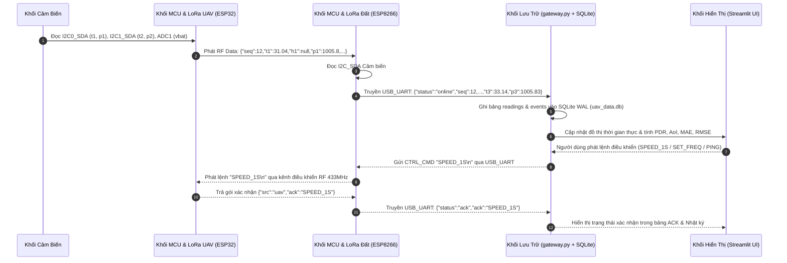

# System Architecture, Flowchart & Data Flow Diagrams

Thư mục này chứa toàn bộ sơ đồ kỹ thuật chuẩn hóa của hệ thống **Adaptive IoT-UAV Environmental Monitoring System (Nhóm 5 — IOT102)**:
1. **Hardware Block Diagram** (*Sơ đồ khối phần cứng*)
2. **System Algorithm Flowchart — Chuẩn ANSI X3.5 / ISO 5807** (*Lưu đồ thuật toán hệ thống*)
3. **End-to-End Telemetry & Command Data Flow** (*Sơ đồ luồng dữ liệu & điều khiển 2 chiều*)

---

## 1. Hardware Block Diagram (Sơ Đồ Khối Phần Cứng)

> **Quy ước đường dây & mũi tên tín hiệu:**
> - **Nét liền 1 chiều (`-->`):** Đường cấp nguồn (`+12V DC`, `+5.0V VCC`, `+3.3V VDD`) và tín hiệu tương tự 1 chiều (`ADC1_CH6`).
> - **Nét liền 2 chiều (`<-->` / `<==>`):** Bus dữ liệu số 2 chiều (`I2C_SDA`, `UART_TX/RX`, `USB_UART`, `SQL_IO`, `RF Data`).
> - **Nét đứt (`-.->` / `<-.->`):** Tín hiệu xung nhịp (`I2C_SCL`) và tín hiệu điều khiển trạng thái (`CTRL_M0/M1`, `CTRL_CMD`, `ACK`).

---

## 2. System Algorithm Flowchart (Lưu Đồ Thuật Toán — Chuẩn ANSI X3.5 / ISO 5807)

> **Quy ước hình khối chuẩn ISO 5807:**
> - **Hình bầu dục `([...])`:** Điểm Bắt đầu (`Start`) và Kết thúc (`End`).
> - **Hình chữ nhật `[...]`:** Bước xử lý nội bộ (`Process`).
> - **Hình bình hành `[/.../]`:** Thao tác Nhập / Xuất dữ liệu (`Input / Output`).
> - **Hình thoi `{...}`:** Điểm kiểm tra điều kiện rẽ nhánh (`Decision: Đúng / Sai`).
> - **Hình tròn nhỏ `(( ))`:** Điểm nối vòng lặp trong trang (`On-Page Connector`).

### 2.1. Lưu Đồ Con A: Thuật Toán Trạm Bay UAV (ESP32 Firmware)

### 2.2. Lưu Đồ Con B: Thuật Toán Trạm Mặt Đất (ESP8266 & Gateway)

---

## 3. End-to-End Telemetry & Command Data Flow (Luồng Dữ Liệu & Điều Khiển 2 Chiều)

> **Quy ước mũi tên tuần tự:**
> - **Mũi tên nét liền (`->>`):** Luồng dữ liệu cảm biến và lưu trữ cơ sở dữ liệu (*Data Bus*).
> - **Mũi tên nét đứt (`-->>`):** Luồng lệnh điều khiển từ người dùng và gói xác nhận (*Control & ACK*).

