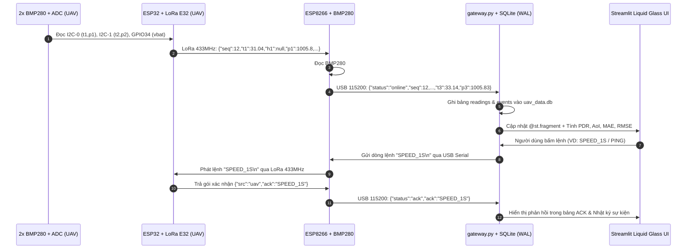

# System Architecture, Flowchart & Data Flow Diagrams

Thư mục này chứa toàn bộ sơ đồ kỹ thuật của hệ thống **Adaptive IoT-UAV Environmental Monitoring System (Nhóm 5 — IOT102)**:
1. **Block Diagram & Hardware Interfacing** (`Block_Diagram.svg`)
2. **Firmware Control Flowchart & Finite State Machine** (`Flowchart_FSM.svg`)
3. **End-to-End Telemetry & Command Data Flow** (`System_DataFlow.svg`)

---

## 1. System Block Diagram & Hardware Interfacing

```mermaid
flowchart LR
    subgraph UAV["1. TRẠM BAY UAV (ESP32 DevKit V1)"]
        direction TB
        LIPO["Pin LiPo 3S (11.1V - 12.6V)"] -->|"IN+ / IN-"| BUCK["Mạch hạ áp Mini 360<br/>(Chỉnh chuẩn OUT+ = 5.0V)"]
        LIPO -.->|"Cầu phân áp 100kΩ / 33kΩ"| ADC["ADC1: GPIO 34<br/>(Đo vbat, bat%, pwr)"]
        BUCK -->|"5.0V & GND"| ESP32["MCU: ESP32 DevKit V1<br/>(Watchdog 15s + Dual I2C)"]
        BUCK -->|"VCC 5.0V & GND"| LORA_TX["Module LoRa E32-433T20D<br/>(M0 = M1 = GND, AUX trống)"]
        BMP1["BMP280 #1 (Không vỏ)<br/>VIN=3V3, GND=GND"] <-->|"I2C-0 (Wire)<br/>SDA=GPIO 21, SCL=GPIO 22"| ESP32
        BMP2["BMP280 #2 (Vỏ Pagoda)<br/>VIN=3V3, GND=GND"] <-->|"I2C-1 (Wire1)<br/>SDA=GPIO 18, SCL=GPIO 19"| ESP32
        ESP32 <-->|"UART2 (9600 8N1)<br/>RX2=GPIO 16, TX2=GPIO 17"| LORA_TX
    end

    subgraph RF["KÊNH VÔ TUYẾN LoRa 433 MHz"]
        direction TB
        LINK["Truyền trong suốt (Transparent Mode 0)<br/>Downlink: JSON Telemetry + ACK<br/>Uplink: SPEED_1S | SPEED_5S | SET_FREQ:n | PING | RESET_UAV"]
    end

    subgraph GND["2. TRẠM MẶT ĐẤT (ESP8266 NodeMCU) & PC"]
        direction TB
        LORA_RX["Module LoRa E32-433T20D<br/>(VCC=VIN 5V, M0=M1=GND)"] <-->|"SoftSerial (Buffer 256B)<br/>D2 (GPIO4)=RX, D1 (GPIO5)=TX"| ESP8266["MCU: ESP8266 NodeMCU<br/>(Heartbeat Timeout = 12s)"]
        BMP3["BMP280 #3 (Mặt đất)<br/>VIN=3V, GND=G"] <-->|"I2C Ground<br/>SDA=D5 (GPIO14), SCL=D6 (GPIO12)"| ESP8266
        ESP8266 <-->|"USB Serial 115200 bps<br/>(Cấp nguồn 5V + Truyền JSON)"| GW["Backend: gateway.py<br/>(Daemon Thread + Whitelist Cmd)"]
        GW <-->|"PRAGMA journal_mode=WAL"| DB[("SQLite DB<br/>uav_data.db")]
        DB <--> UI["Streamlit Dashboard (app.py)<br/>Apple Liquid Glass UI + RBL KPIs"]
    end

    LORA_TX <==>|"433 MHz RF"| LINK
    LINK <==>|"433 MHz RF"| LORA_RX
```

---

## 2. Firmware Control Flowchart & Exception Handling (FSM)

```mermaid
flowchart TD
    subgraph UAV_FLOW["A. LƯU ĐỒ FIRMWARE TRẠM UAV (ESP32)"]
        U1(["Khởi động ESP32 (setup)"]) --> U2["Cấu hình UART2 (9600), ADC GPIO 34<br/>Dual I2C: Wire(21/22), Wire1(18/19) + setTimeOut(50ms)<br/>Khởi tạo Hardware Watchdog = 15s"]
        U2 --> U3["Vòng lặp loop(): Gọi esp_task_wdt_reset()"]
        U3 -.->|"Nếu treo > 15s"| U_WDT["Watchdog Panic: Tự động Hard-Reset ESP32"]
        U3 --> U4{"Serial2.available()<br/>Có lệnh từ mặt đất?"}
        U4 -->|"Có"| U5["Đọc không chặn vào cmdBuf[32]<br/>Thực thi: SPEED_1S / 5S / SET_FREQ:n / PING / RESET<br/>Gửi phản hồi: {'src':'uav','ack':'...'}"]
        U4 -->|"Không"| U6{"Đủ chu kỳ lấy mẫu?<br/>millis() - lastRead >= readInterval"}
        U5 --> U6
        U6 -->|"Chưa"| U3
        U6 -->|"Đủ chu kỳ"| U7["Kiểm tra cờ bme1_ok, bme2_ok<br/>Nếu false -> Gọi lại initBMP() tự phục hồi"]
        U7 --> U8["Đọc t1, p1 và t2, p2 (BMP280: h1=null, h2=null)<br/>Nếu NaN hoặc p ngoài [300, 1100] -> Gán null"]
        U8 --> U9["Đo áp pin GPIO 34 (trung bình 16 mẫu)<br/>Nếu V_bat < 6.0V -> pwr='usb', bat=null"]
        U9 --> U10["Đóng gói JSON 1 dòng + Tăng seqNo++<br/>Phát qua LoRa E32 (Serial2.println)"]
        U10 --> U3
    end

    subgraph GND_FLOW["B. LƯU ĐỒ TRẠM MẶT ĐẤT (ESP8266) & MÁY TRẠNG THÁI"]
        G1(["Khởi động ESP8266 (setup)"]) --> G2["USB Serial (115200) | SoftSerial LoRa (9600, 256B)<br/>I2C BMP280 #3 (SDA=D5, SCL=D6)"]
        G2 --> G3{"Nhận dòng JSON<br/>từ LoRa?"}
        G3 -->|"Gói ACK"| G4["Xuất lên PC: {'status':'ack','ack':'...'}"]
        G3 -->|"Gói Telemetry"| G5["Cập nhật lastLoraReceived = millis()<br/>Đọc BMP280 #3 (t3, p3, h3=null)<br/>Xuất lên PC: {'status':'online', ...}"]
        G3 -->|"Không có gói"| G6{"Quá 12 giây mất sóng?<br/>now - lastLoraReceived > 12000ms"}
        G6 -->|"Quá 12s (mỗi 5s/lần)"| G7["Đọc BMP280 #3 mặt đất<br/>Xuất cảnh báo: {'status':'offline','t3':...}"]
        G6 -->|"Chưa quá 12s"| G8{"Có lệnh từ PC<br/>qua USB Serial?"}
        G4 --> G8
        G5 --> G8
        G7 --> G8
        G8 -->|"Có"| G9["Chuyển tiếp lệnh qua LoRa E32 lên UAV"]
        G8 -->|"Không"| G3
        G9 --> G3
    end
```

---

## 3. End-to-End Telemetry & Command Data Flow

